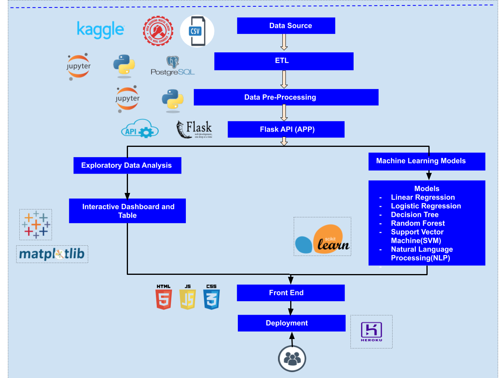
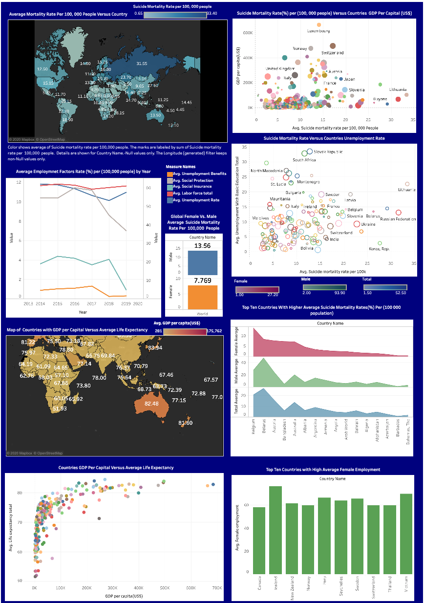

# Mental Health Risk Indicators to Inform Suicide Prevention

## Background

Suicide remains a significant global public health concern. According to the World Health Organization (WHO), approximately 800,000 people die by suicide each year worldwide, with substantial variation across countries and over time. Beyond mortality, many more individuals experience suicidal ideation or attempts, underscoring the importance of prevention-focused research and policy responses.

Existing literature consistently identifies two broad domains associated with suicide mortality at the population level. The first concerns **structural and socio-economic conditions**, including income, education, employment, and social protection systems. The second focuses on **mental health–related factors**, such as the prevalence of mental disorders, access to care, and treatment availability (Li et al., 2011). Prior studies suggest that prevention strategies targeting either domain may yield comparable population-level effects.

Motivated by this evidence, this project examines how selected socio-economic and mental health indicators relate to suicide mortality rates across countries and over time. The analysis is conducted at an aggregated, population level and is intended to support prevention-oriented understanding and policy discussion. This work does **not** aim to predict individual suicide risk or support clinical decision-making.

---

## Project Objectives

### Research Focus

This project addresses the following research question:

**Which population-level socio-economic and mental health indicators are most strongly associated with national suicide mortality rates across countries and years, and how can data-driven methods help identify patterns relevant to suicide prevention planning?**

---

## Indicators Examined

### Socio-Economic and Structural Indicators

The analysis includes a range of national-level indicators, such as:

- Economic development (GDP, GDP per capita)
- Poverty and inequality measures
- Labor force participation and employment indicators
- Coverage of social insurance and social protection programs
- Education attainment
- Life expectancy and demographic structure
- Healthcare expenditure and access
- Population density and internet penetration

These indicators are sourced primarily from the World Bank World Development Indicators (WDI) database.

### Mental Health and Workplace Context Indicators

To complement macro-level indicators, the project incorporates aggregated insights from workplace mental health surveys, focusing on:

- Access to mental health services
- Insurance coverage and benefits
- Workplace openness and stigma
- Perceived consequences of disclosure
- Availability of wellness programs
- Organizational size and industry context

These data are used for descriptive and exploratory purposes and are interpreted in relation to broader national contexts.

---

## Methodology

This project integrates multiple analytical approaches:

- **Data cleaning and preprocessing**
- **Exploratory data analysis (EDA)**
- **Data visualization using Tableau**
- **Statistical analysis**
- **Machine learning models** to explore associations and relative explanatory strength

### Analytical Scope

- The analysis focuses on **population-level associations**, not causal inference.
- Models are used to explore patterns and relationships, not deterministic prediction.
- Results are interpreted with attention to contextual and data-quality limitations.

---

## Data Sources

### Data Source 1: World Development Indicators (World Bank)

The World Development Indicators dataset provides macro-level socio-economic and demographic indicators for approximately 246 countries across multiple income categories.

- Outcome variable: Suicide mortality rate (per 100,000 population)
- Explanatory variables: Selected socio-economic and structural indicators
- Country identifiers are included as key features

Selected indicators are documented in:  
`Data/raw_data/Data_Extract_From_World_Development_Indicators_metadata.csv`

### Data Source 2: OSMI Mental Health in Tech Survey

The OSMI Mental Health in Tech Survey provides aggregated survey data related to workplace mental health, access to care, and organizational culture. The dataset contains 27 variables and is used for descriptive and exploratory analysis.

---

## System Architecture

---

## Deployment and Presentation

**Live site:** [ermiasgelaye.github.io/Mental-Health-Predictor](https://ermiasgelaye.github.io/Mental-Health-Predictor/) — free on GitHub Pages, no server or database, so it never sleeps or goes down.

The site uses the same design system as the [portfolio](https://ermiasgelaye.github.io/) (light/dark themes, mobile layout, project assistant with crisis-support safeguard).

| Path | What it is |
|---|---|
| `index.html` | Overview: background, real world map of suicide rates, survey explorer, findings, country indicators, model summary, corrections, methodology, references |
| `ml.html` | Machine-learning results with the notebook's figures and an honest evaluation |
| `eda.html` | The original Tableau Public dashboards (loaded on request) |
| `data.html` | Filterable/exportable survey and indicator tables, data quality & limitations |
| `api.html` | The API endpoints (`/mental_health`, `/indicator`) with live "Try it" |
| `assets/js/mental.js` | All statistics and charts, computed in the browser from `assets/data/mental.data.js` |
| `static/data/*.json` | The former `/mental_health` and `/indicator` API endpoints as static files |
| `tools/clean_data.py`, `tools/build_static.py` | Data corrections and data build |
| `tools/build_map.py` | Projects Natural Earth country shapes (`Data/geo/`, world-atlas) into `assets/data/worldmap.data.js` |
| `tools/sync_design.sh` | Re-copies the shared CSS/JS/chat from the portfolio repo |
| `app.py` | Optional: serves the site locally and keeps the old URLs working |

After editing `Data/survey.csv` or `Data/database/indicator.csv`: `python3 tools/clean_data.py && python3 tools/build_static.py`.

To publish: GitHub → *Settings → Pages* → Deploy from branch `master`, folder `/ (root)`.

### Data corrections (2026 audit)
- **Excel date corruption:** company sizes "1-5" and "6-25" were stored as "05-Jan" and "25-Jun" (452 rows) — fixed in `survey.csv`.
- **Impossible ages** (−1726, 5, 329, 99,999,999,999 …; 8 respondents) are treated as missing, and one duplicate response is dropped.
- **46 World Bank aggregates** ("World", "High income", "Euro area" …) were mixed in with 217 countries; they're flagged and excluded from country statistics.
- Suicide-rate data exists only for **2015–2016**, so country comparisons use that period.

### Key findings (2026 re-analysis)

| # | Finding | Evidence |
|---|---|---|
| 1 | **Family history is the strongest predictor of having sought treatment.** | Adjusted odds ratio 4.53 (95% CI 3.46–5.93), multivariable logistic regression, n = 1,258. |
| 2 | **Men have less than half the odds of women** of having sought treatment. | aOR 0.45 (0.32–0.63). Nationally, men die by suicide ~2.9× as often as women. |
| 3 | **Workplace support matters after adjustment**; remote work and tech-company employment don't. | Knows care options aOR 2.24 (1.58–3.19); benefits 1.73 (1.18–2.54); remote 1.05, tech company 1.00 (n.s.). |
| 4 | **"Work interference" leaks the outcome.** | People without a condition answer "NA"; including it lifts cross-validated AUC from 0.77 to 0.90. |
| 5 | **World region explains 24% of differences in national suicide rates.** | One-way ANOVA (η² = 0.24, p < 0.001), 183 countries; Europe & Central Asia 13.6 vs Middle East & North Africa 4.3 per 100k. |
| 6 | **Several indicator links are confounded by region.** | Social insurance: raw +3.1 per SD (p = 0.001) → region-adjusted +1.6 (p = 0.29). Survive: basic-education labour share (−2.7, p = 0.001), educational attainment (+2.2, p = 0.035), GDP (+1.2, p = 0.023). |
| 7 | **National suicide rates can't be predicted well from these indicators.** | 10×5-fold cross-validated R² on all 183 countries: indicators 0.20, region alone 0.16, random forest 0.15. |

Reproduce: `python3 tools/clean_data.py && python3 tools/build_static.py && python3 tools/build_map.py && python3 tools/analyze.py` (World Bank region metadata: `tools/fetch_external.py` → `Data/external/`).

### Original model results
Only 58 countries had every indicator. Regression models failed on held-out countries (test R² −0.60 to 0.13). The best classifiers (linear SVM, tuned random forest) reached 72% test accuracy on 18 countries, against a 61% baseline of always predicting "low".

---

## Exploratory Data Analysis

Following data cleaning and integration, exploratory data analysis was conducted using Tableau. The dashboards visualize:

- Regional variation in suicide mortality rates
- Temporal trends
- Associations between suicide mortality and selected indicators

---

## Machine Learning Analysis

Several machine learning models were applied to explore relationships between suicide mortality rates and contextual indicators, including:

- Linear Regression  
- Logistic Regression  
- Support Vector Machines  
- Decision Trees  
- Random Forests  

These models were used to compare relative performance and identify recurring patterns rather than to produce operational predictions.

---

## Data Preprocessing and Correlation Analysis

Prior to modeling, the data were cleaned, normalized, and examined for correlations.

The correlation analysis identified:
- A positive association between suicide mortality rates and social insurance coverage
- A negative association between suicide mortality rates and the proportion of the population with basic education

---

## Model Results

### Regression Models

Linear regression, decision tree regression, and support vector regression were applied to estimate suicide mortality rates. None generalised well to held-out countries: support vector regression scored highest (test R² 0.13), while decision tree regression scored lowest (−0.60) despite a perfect training fit — a sign of overfitting. *(An earlier version of this README stated the reverse.)*

Code is available at:  
https://github.com/ermiasgelaye/Mental-Health-Predictor/blob/master/machine_learning_analysis.ipynb

### Classification Models

For comparative purposes, suicide mortality rates were categorized into above- and below-average groups. Classification models were evaluated to assess relative accuracy, with support vector machines demonstrating higher performance following parameter tuning (72% test accuracy on 18 countries, vs. a 61% baseline of always predicting "low").

---

## Conclusions

This project demonstrates that suicide mortality is associated with a complex interaction of socio-economic and mental health–related factors at the population level. No single indicator sufficiently explains observed patterns, reinforcing the need for multifaceted, prevention-focused approaches.

While data limitations and contextual variability constrain interpretation, population-level analysis can contribute to evidence-informed discussion and support public health planning. All findings should be interpreted as associative rather than causal.

---

## References

- Ferretti, F., & Coluccia, A. (2009). Socio-economic factors and suicide rates in European Union countries. *Legal Medicine, 11*.  
- Li, Z., Page, A., Martin, G., & Taylor, R. (2011). Attributable risk of psychiatric and socio-economic factors for suicide. *Social Science & Medicine, 72*(4), 608–616.  
- National Alliance on Mental Health. (2013). Mental Health Conditions.  
- Szanto, K. (2017). Cognitive deficits as contributors to suicide. *American Journal of Geriatric Psychiatry, 25*(6), 630–632.  
- World Bank. (2020). World Development Indicators.  
- World Health Organization. (2019). Suicide Fact Sheet.

- World Health Organization. (2020). Mental Health.  
- World Health Organization. (2017). Depression and other common mental disorders.

